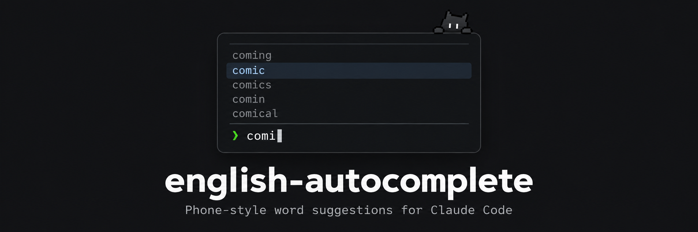

# english-autocomplete

[English](README.md) | **한국어**

Claude Code 입력창에서 영어 단어를 칠 때, 스마트폰 키보드처럼 단어를 추천해 주는
플러그인입니다. 영어 단어를 두 글자 이상 입력하면 입력창 위에 많이 쓰는 순서대로
후보가 최대 5개 나타납니다. 처음 입력한 대소문자는 그대로 유지됩니다
(`Recom` -> `Recommend`).

Claude Code 2.1.292 이상이 필요합니다 (`prompt.autocomplete` 플러그인 이벤트 사용).

## 설치

### Claude Code

Claude Code 터미널 세션에서 다음을 입력합니다.

```
/plugin install english-autocomplete --marketplace magatone/claude-autocomplete
```

마켓플레이스를 추가할지 물으면 `y`를 누르고, 설치 범위를 고릅니다 (기본값은 user 범위).

### Codex CLI (`codex-auto`, 고정 버전)

**`codex-auto`로 기본 입력창에 영어 단어 자동완성이 있는 Codex CLI를 사용할 수 있습니다. 이 배포는 Codex 0.161.0 고정 버전이며 자동 업데이트를 지원하지 않습니다.** 공식 `codex`를 업데이트해도 `codex-auto`는 바뀌지 않으며, `codex-auto update` 명령도 지원하지 않습니다.

같은 컴퓨터의 기존 Codex 계정·설정·세션을 공유합니다. 영어 두 글자 이상 입력 후 ↑↓로 선택하고 Tab으로 삽입합니다. Enter는 메시지를 전송합니다. 아래 오타 교정·저장 단축어는 Claude 플러그인 기능입니다.

이번 배포는 **소스 배포**로, 빌드 도구가 필요하며 컴파일된 실행 파일은 포함하지 않습니다. Windows는 로컬 검증했으며 Mac 빌드 안내는 미검증입니다. [Windows/macOS 설치 절차](codex/README.ko.md)를 완료한 뒤 실행합니다.

```sh
codex-auto --version
codex-auto
```

예상 버전은 `codex-cli 0.161.0`입니다. 버전 동기화·자동 업데이트 실험은 잠시 중단하고 [`feat/codex-version-sync`](https://github.com/magatone/claude-autocomplete/tree/feat/codex-version-sync)와 [Draft PR #2](https://github.com/magatone/claude-autocomplete/pull/2)에 보존했습니다.

## 사용 방법

1. 입력창에 영어 단어를 두 글자 이상 입력합니다 (예: `recom`).
2. 입력창 위에 많이 쓰는 순서대로 추천 단어가 최대 5개 나타납니다.
3. 위/아래 화살표 키로 원하는 단어를 고릅니다.
4. `Tab`을 누르면 입력하던 글자가 고른 단어로 바뀝니다.

## 오타 추천

철자를 틀렸나요? 친 글자와 정확히 맞는 단어가 없으면, 원래 치려던 것 같은 단어를
`typo?` 표시와 함께 추천합니다. 골라서 `Tab`을 누르면 바로 고쳐집니다.

```
   deploy        typo?
   deployment    typo?
❯ depoly
```

실수 한 번까지 알아봅니다: 두 글자 순서 바뀜(`depoly`), 한 글자 빠짐(`funtion`),
한 글자 더 들어감(`commmit`), 한 글자 잘못 누름(`deplay`). 네 글자부터 동작하고,
첫 글자는 맞게 쳤다고 보며, 바르게 칠 때는 나타나지 않습니다.
자주 틀리는 오타 60개로 시험했을 때 58개를 잡았고, 바르게 칠 때 끼어든 적은 없었습니다.

## 숏컷

자주 쓰는 문장을 짧은 이름으로 저장해 두고, 이름을 친 다음 `Tab`을 누르면 문장으로 바뀝니다.
예를 들어 `ptg`를 `push to github`로 등록하면, `ptg`를 쳤을 때 추천 목록 맨 위에 `push to github`가 뜹니다.

등록 방법은 두 가지이고, 둘 다 같은 목록에 저장됩니다. Claude Code를 다시 켜도 남아 있습니다.

**명령어로 등록하기**

```
/shortcut add ptg push to github
/shortcut list
/shortcut remove ptg
```

**Claude에게 부탁하기**

> ptg를 push to github으로 숏컷 등록해 줘

숏컷 목록 보여 주기, 지우기도 말로 부탁할 수 있습니다.

숏컷 이름은 영어로 시작하는 2글자 이상의 영문·숫자 조합입니다(`ptg`, `pr2`). 대소문자는 구분하지 않습니다.
숏컷은 단어 추천보다 먼저 뜹니다.

## 업무 용어

일상 영어 외에도 Claude Code에서 업무할 때 많이 쓰는 단어 약 900개를 분야별로 나눠
`data/terms/`에 담았습니다: `common`(공통), `planning`(기획), `frontend`(프론트엔드),
`backend`(백엔드·서버), `infra`(인프라·엔지니어링), `devtools`(개발 도구·워크플로), `design`(디자인),
`ai`(LLM·에이전트), `ax`(AI 도입·전환), `tools`(`TypeScript`, `LLM` 같은 고유 이름과 약어, 대소문자 그대로 유지). 이 단어들이 최대 3개까지 먼저 나오기 때문에 `comm`을 치면
`community`보다 `command`, `commit`이 먼저 뜹니다. 세 글자 이하로 쳤을 때는 1개만 먼저 나와서
일상 단어도 함께 보입니다. 단어를 추가하려면 `data/terms/` 안의 `.txt` 파일에 한 줄에 하나씩 적으면 됩니다.

## 업데이트 내역

- **0.6.1** 사용 가능한 고정 버전 `codex-auto` CLI 안내 및 자동 업데이트 실험 중단. 사전 빌드 파일 없는 소스 배포.

- **0.6.0** Codex를 위한 별도 CLI 구현: 기본 입력창 소스를 수정한 실험판을 `codex-auto` 명령으로 실행.

- **0.5.0** 오타 추천: 정확히 맞는 단어가 없으면 원래 치려던 단어를 `typo?` 표시와 함께 추천.
- **0.4.0** 업무 용어 약 300개 추가: AI, AX(AI 도입·전환), 개발 도구, 약어와 AI 도구 이름.
- **0.3.0** 숏컷: `/shortcut add ptg push to github` 또는 Claude에게 말로 등록.
- **0.2.0** 직군별 업무 용어: `comm`을 치면 `commit`이 먼저.
- **0.1.0** 첫 버전: 입력창에서 영어 단어 추천.

## 개발

```
claude --plugin-dir ./claude-autocomplete
claude plugin test ./claude-autocomplete
```

## 앞으로의 계획

Codex 기본 입력창 자동완성은 별도 수정 CLI로 실험 구현했습니다. 설치형 Codex 플러그인·스킬 지원은 구현하지 않았습니다. [설치·제한 사항](codex/README.ko.md)을 참고하세요.

## 다른 언어

이 문서는 영어와 한국어로 제공됩니다. 다른 언어는 수요가 확인되면 추가할 예정입니다.

## 라이선스

- 코드와 `data/terms/`의 직군별 단어 목록: MIT, `LICENSE` 참고.
- 단어 목록 (`data/wordfreq-en-25000-log.json`):
  [aparrish/wordfreq-en-25000](https://github.com/aparrish/wordfreq-en-25000)에서 가져왔으며,
  Robyn Speer의 [wordfreq](https://github.com/rspeer/wordfreq)에서 추출한 목록입니다.
  wordfreq 데이터는 [CC BY-SA 4.0](https://creativecommons.org/licenses/by-sa/4.0/) 라이선스이며,
  이 단어 목록도 같은 라이선스로 재배포합니다.
  부적절한 단어는 걸러져 있지 않습니다.
